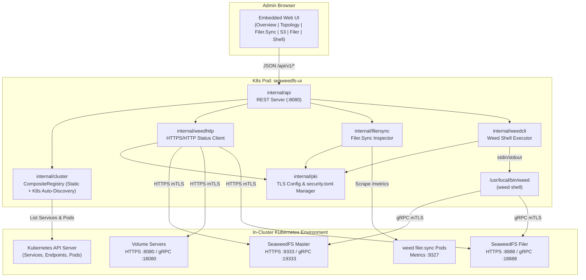

# SeaweedFS In-Cluster Admin Web UI (`seaweedfs-ui`)

A lightweight, cloud-native administration console for Kubernetes-hosted [SeaweedFS](https://github.com/seaweedfs/seaweedfs) clusters. Built with a single-binary Go backend, an embedded zero-build Vanilla ES Module frontend, and the official `weed` CLI for authoritative administrative gRPC operations.

---

## Key Features

- **Hybrid Data Plane (`weedhttp` + `weed shell`)**:
  - **Fast HTTPS/HTTP Probes**: Polls Master (`/cluster/status`, `/dir/status`, `/vol/status`), Filer directory listings, and `filer.sync` Prometheus `/metrics` with multi-master failover and 307 redirect handling.
  - **Authoritative `weed shell` Wrapper**: Executes cluster maintenance (`volume.vacuum`, `volume.balance`, `volume.fix.replication`, `volume.grow`), S3 bucket/IAM operations (`s3.bucket.*`, `s3.configure`), and metadata inspection (`fs.meta.cat`) over `stdin`/`stdout` with automatic `lock`/`unlock` framing.
- **Hybrid Cluster Discovery**:
  - Combines static clusters from `config.yaml` (`StaticProvider`) with automatic in-cluster Kubernetes Service, headless Endpoint, and Pod discovery (`K8sDiscoveryProvider`).
- **First-Class PKI / TLS / mTLS**:
  - Wires custom Root CAs (`ca.crt`) and client X.509 certificates (`tls.crt`, `tls.key`) into both HTTPS probes (`*tls.Config` with live rotation reload) and `weed shell` gRPC connections (auto-generating `$HOME/.seaweedfs/security.toml` on an in-memory `emptyDir` volume for `readOnlyRootFilesystem: true` compatibility).
- **Live `filer.sync` Replication Monitor**:
  - Discovers running `weed filer.sync` pods/targets, parses `-a`/`-b` source and target Filer flags, scrapes Prometheus `/metrics` endpoints, and calculates real-time replication lag.
- **Safe by Default**:
  - Runs in **Read-Only Mode** by default (`allowAdminActions: false`, `enableRawShell: false`), enforcing guardrails in both the REST API middleware and CLI executor with structured JSON audit logging.

---

## Architecture



---

## Web UI Views

1. **Overview**: Cluster switcher (with `K8s`/`Static` and `TLS` badges), `READ-ONLY` vs `ADMIN WRITE ENABLED` status badge, Raft quorum and leader status, storage capacity gauges, and volume slot utilization.
2. **Topology & Volumes**: Collapsible `DataCenter -> Rack -> DataNode -> Volume` hierarchy, filters (collection, replication placement, read-only state, high garbage ratio), and one-click maintenance actions (`Vacuum`, `Balance`, `Fix Replication`, `Grow`).
3. **Filer Sync (`filer.sync` Monitor)**: Directional `Source Filer -> Target Filer` cards displaying replication mode (`Active-Active` / `Active-Passive`), pod health, colour-coded replication lag badge, throughput, synced file counters, and errors.
4. **S3 Buckets & IAM**: Bucket list with creation/deletion workflows (gated by `allowAdminActions`) and S3 IAM user/policy tables parsed from `s3.configure`.
5. **Filer Browser**: Directory breadcrumb explorer with file sizes, chunk counts, MIME types, file download/upload/delete support, and an inode metadata drawer (`fs.meta.cat`).
6. **Weed Shell Console**: Curated read-only command presets (`cluster.status`, `volume.list`, `s3.bucket.list`, `s3.configure`, `ec.shard.list`, `fs.ls /`), execution duration timer, and an optional raw command console (`enableRawShell: true`).

---

## Quick Start

### 1. Deploy with Helm (In-Cluster)

Install with default cluster-wide read-only Kubernetes discovery:

```bash
helm install seaweedfs-ui ./charts/seaweedfs-ui \
  --namespace seaweedfs \
  --create-namespace
```

Install with **PKI / mTLS enabled** (mounting an existing Kubernetes Secret containing `ca.crt`, `tls.crt`, and `tls.key`) and namespace-scoped RBAC:

```bash
helm install seaweedfs-ui ./charts/seaweedfs-ui \
  --namespace seaweedfs \
  --set rbac.clusterWide=false \
  --set config.tls.enabled=true \
  --set config.tls.existingSecret=seaweedfs-client-tls
```

Access the UI locally via `kubectl port-forward`:

```bash
kubectl -n seaweedfs port-forward svc/seaweedfs-ui 8080:8080
# Open http://localhost:8080
```

### 2. Build & Package with Nix

The repository provides a hermetic `flake.nix` with three chained derivations (`seaweedfs-ui` executable $\rightarrow$ `docker-image` $\rightarrow$ `helm-chart`):

```bash
# 1. Build the Go executable (and run Go unit tests)
nix build .#seaweedfs-ui
./result/bin/seaweedfs-ui --version

# 2. Build the hardened multi-arch OCI/Docker images (linux/amd64 and linux/arm64)
nix build .#docker-image-amd64 --out-link result-image-amd64
nix build .#docker-image-arm64 --out-link result-image-arm64

# 3. Lint, template-verify, and package the Helm chart (.tgz)
nix build .#helm-chart
ls -la result/
```

### 3. Build with Go / Docker

```bash
# Build binary directly
go build -o bin/seaweedfs-ui ./cmd/seaweedfs-ui

# Run locally with a config file
./bin/seaweedfs-ui -config /path/to/config.yaml -listen :8080

# Or build the multi-stage Dockerfile
docker build -t seaweedfs-ui:local .
```

---

## Configuration Reference

`seaweedfs-ui` loads configuration in the following precedence order: **CLI Flags > Environment Variables > YAML Config File (`/etc/seaweedfs-ui/config.yaml`) > Defaults**.

### Example `config.yaml`

```yaml
listenAddr: ":8080"
allowAdminActions: false          # Env: ALLOW_ADMIN_ACTIONS
enableRawShell: false             # Env: ENABLE_RAW_SHELL
queryTimeout: "15s"               # Env: QUERY_TIMEOUT
actionTimeout: "120s"             # Env: ACTION_TIMEOUT
weedBinaryPath: "/usr/local/bin/weed" # Env: WEED_BINARY_PATH

tls:
  enabled: true                   # Env: TLS_ENABLED
  insecureSkipVerify: false       # Env: TLS_INSECURE_SKIP_VERIFY
  caFile: "/etc/seaweedfs-ui/tls/ca.crt"     # Env: TLS_CA_FILE
  certFile: "/etc/seaweedfs-ui/tls/tls.crt"  # Env: TLS_CERT_FILE
  keyFile: "/etc/seaweedfs-ui/tls/tls.key"   # Env: TLS_KEY_FILE
  securityTomlPath: "/tmp/seaweedfs/security.toml" # Env: SECURITY_TOML_PATH

discovery:
  kubernetes:
    enabled: true                 # Env: K8S_DISCOVERY_ENABLED
    clusterWide: true             # Env: K8S_DISCOVERY_CLUSTER_WIDE
    namespaces: []                # Env: K8S_NAMESPACES (comma-separated)
    refreshInterval: "30s"        # Env: K8S_REFRESH_INTERVAL
    serviceSelector: "app.kubernetes.io/name=seaweedfs"        # Env: K8S_SERVICE_SELECTOR
    filerSyncPodSelector: "app.kubernetes.io/component=filer-sync" # Env: K8S_FILER_SYNC_POD_SELECTOR

clusters:
  - id: "local-prod"
    name: "Production SeaweedFS"
    namespace: "seaweedfs"
    masters:
      - "seaweedfs-master-0.seaweedfs-master.seaweedfs.svc.cluster.local:9333"
    filer: "seaweedfs-filer.seaweedfs.svc.cluster.local:8888"
    s3: "seaweedfs-s3.seaweedfs.svc.cluster.local:8333"
    filerSyncs:
      - id: "prod-to-dr"
        name: "Prod to DR Sync"
        metricsUrl: "https://seaweedfs-filer-sync.seaweedfs.svc.cluster.local:9327/metrics"
        sourceFiler: "seaweedfs-filer.seaweedfs.svc.cluster.local:8888"
        targetFiler: "seaweedfs-dr-filer.seaweedfs-dr.svc.cluster.local:8888"
```

### CLI Flags

| Flag | Environment Variable | Default | Description |
| :--- | :--- | :--- | :--- |
| `-config` | — | `/etc/seaweedfs-ui/config.yaml` | Path to YAML configuration file |
| `-listen` | `LISTEN_ADDR` / `PORT` | `:8080` | HTTP server listen address |
| `-allow-admin-actions` | `ALLOW_ADMIN_ACTIONS` | `false` | Enable mutating admin actions (`vacuum`, `balance`, bucket create/delete) |
| `-enable-raw-shell` | `ENABLE_RAW_SHELL` | `false` | Enable raw `weed shell` command input |
| `-weed-binary` | `WEED_BINARY_PATH` | `/usr/bin/weed` | Path to the `weed` CLI binary |
| `-query-timeout` | `QUERY_TIMEOUT` | `15s` | Timeout for read-only HTTP and CLI queries |
| `-action-timeout` | `ACTION_TIMEOUT` | `120s` | Timeout for mutating maintenance commands |
| `-version` | — | — | Print version, commit, and build date |

---

## Testing & Verification

Run the full unit, adversarial, Helm chart, and end-to-end mTLS test suite:

```bash
go vet ./...
go test -v -race ./...
helm lint charts/seaweedfs-ui
```

---

## Documentation

- [SPEC.md](./SPEC.md) — Detailed technical and architectural specification
- [PROJECT.md](./PROJECT.md) — Module contracts, feature inventory, and code layout
