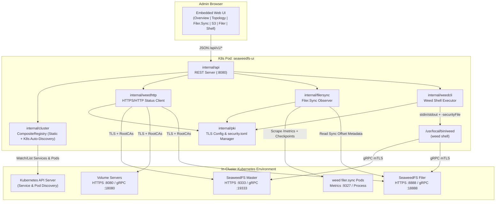

# SeaweedFS In-Cluster Admin Web UI — Technical & Agent Implementation Specification

**Status:** Approved for Implementation  
**Target Environment:** Kubernetes (in-cluster local SeaweedFS deployments)  
**Architecture Style:** Loosely-coupled, high-cohesion modular monolith (Single Go binary + embedded Vanilla JS Web UI + `/usr/bin/weed` CLI binary)

---

## 1. Purpose & Design Philosophy

This specification defines a lightweight, self-contained Admin Web UI for observing and operating one or more in-cluster SeaweedFS installations inside Kubernetes. It is structured so autonomous coding agents can implement each package, container build, and Helm chart independently against explicit interfaces and JSON contracts.

### Core Principles
1. **Simplest Pieces:**
   - **Backend:** Go standard library (`net/http`, `os/exec`, `crypto/tls`, `embed`) with minimal external dependencies (`gopkg.in/yaml.v3`).
   - **CLI Wrapper:** Official `/usr/bin/weed` binary packaged in the same container and invoked via `weed shell` for authoritative gRPC administrative actions.
   - **Frontend:** Zero-build-step Vanilla ES Modules + modern CSS variables embedded directly into the Go binary via `//go:embed`. No Node.js, Webpack, or external database required.
2. **Loose Coupling:**
   - Subsystems interact strictly through narrow Go interfaces (`ClusterProvider`, `CLIExecutor`, `StatusClient`, `FilerSyncObserver`) and versioned REST JSON endpoints (`/api/v1/*`).
3. **High Cohesion:**
   - Each internal package owns exactly one domain responsibility (PKI/TLS wiring, cluster discovery, `weed shell` execution, HTTP JSON status probing, `filer.sync` observation, HTTP routing, and static UI).
4. **Safe by Default:**
   - Starts in **Read-Only Mode** (`ALLOW_ADMIN_ACTIONS=false`, `ENABLE_RAW_SHELL=false`). Mutating `weed shell` operations and raw shell commands are gated at both the API middleware and CLI executor layers.
5. **First-Class PKI / TLS / mTLS:**
   - Native support for PKI-secured SeaweedFS clusters across both HTTPS REST probes and `weed shell` gRPC mTLS connections (`security.toml`).

---

## 2. Repository Structure (Work Breakdown for Agents)

```text
seaweedfs-ui/
├── SPEC.md                              # This specification
├── go.mod
├── Dockerfile                           # Multi-stage build (weed binary + Go binary)
├── cmd/
│   └── seaweedfs-ui/
│       └── main.go                      # Entrypoint, flag/env parsing, wiring, graceful shutdown
├── internal/
│   ├── config/
│   │   └── config.go                    # Global config & YAML loader
│   ├── pki/
│   │   ├── tls.go                       # Go *tls.Config builder (CA bundle + client cert/key)
│   │   └── security_toml.go             # Generates/validates security.toml for weed shell gRPC TLS
│   ├── cluster/
│   │   ├── model.go                     # Cluster Target structs & ClusterProvider interface
│   │   ├── static.go                    # ConfigMap / YAML static cluster provider
│   │   ├── k8s_discovery.go             # In-cluster K8s API Service/Pod auto-discovery provider
│   │   └── registry.go                  # Composite registry merging static + K8s discovered clusters
│   ├── weedcli/
│   │   ├── executor.go                  # os/exec wrapper for `weed shell`, lock/unlock, timeouts
│   │   ├── commands.go                  # Structured allowlisted command builders & read-only guard
│   │   └── parser.go                    # Parsers for volume.list, s3.bucket.list, s3.configure, etc.
│   ├── weedhttp/
│   │   └── client.go                    # HTTPS/HTTP JSON client for Master, Volume, and Filer APIs
│   ├── filersync/
│   │   └── observer.go                  # Observes running `weed filer.sync` pods, metrics, & checkpoints
│   └── api/
│       ├── server.go                    # HTTP mux, middleware, static asset serving
│       ├── handlers_cluster.go          # Overview, topology, volumes, and maintenance action handlers
│       ├── handlers_s3_filer.go         # S3 buckets/IAM and Filer browser handlers
│       ├── handlers_filersync.go        # Filer.sync observation handlers
│       └── handlers_shell.go            # Curated & raw weed shell console handler
├── web/
│   ├── embed.go                         # //go:embed index.html css/* js/*
│   ├── index.html                       # Single-page shell
│   ├── css/
│   │   └── styles.css                   # Clean responsive admin theme
│   └── js/
│       ├── app.js                       # State, cluster switcher, router
│       ├── api.js                       # Fetch wrapper for /api/v1/*
│       └── views/
│           ├── overview.js              # Cluster health, Raft leader, capacity
│           ├── topology.js              # DataCenter/Rack/Node/Volume table + maintenance actions
│           ├── filersync.js             # Live filer.sync jobs, lag, throughput, checkpoints
│           ├── s3.js                    # S3 buckets & IAM visualization/management
│           ├── filer.js                 # Filer directory & metadata browser
│           └── shell.js                 # Weed shell runner & output log
└── charts/
    └── seaweedfs-ui/
        ├── Chart.yaml
        ├── values.yaml
        └── templates/
            ├── _helpers.tpl
            ├── serviceaccount.yaml
            ├── rbac.yaml                # Optional Role/ClusterRole for K8s auto-discovery
            ├── configmap.yaml           # Renders config.yaml (and optional security.toml)
            ├── deployment.yaml          # Mounts ConfigMap & PKI TLS Secrets
            ├── service.yaml
            └── ingress.yaml
```

---

## 3. System Architecture



---

## 4. Detailed Component Specifications

### 4.1. `internal/config` — Configuration Schema

Loaded from `/etc/seaweedfs-ui/config.yaml` (with environment variable overrides):

```yaml
listenAddr: ":8080"
allowAdminActions: false          # Env: ALLOW_ADMIN_ACTIONS (default: false)
enableRawShell: false             # Env: ENABLE_RAW_SHELL (default: false)
queryTimeout: 15s                 # Timeout for read-only CLI/HTTP calls
actionTimeout: 120s               # Timeout for mutating maintenance commands
weedBinaryPath: "/usr/local/bin/weed"

# Global PKI / TLS configuration (can be overridden per cluster)
tls:
  enabled: true
  insecureSkipVerify: false
  caFile: "/etc/seaweedfs-ui/tls/ca.crt"
  certFile: "/etc/seaweedfs-ui/tls/tls.crt"
  keyFile: "/etc/seaweedfs-ui/tls/tls.key"
  securityTomlPath: "/tmp/seaweedfs/security.toml" # Auto-generated if not pre-mounted

# Kubernetes Auto-Discovery Configuration
discovery:
  kubernetes:
    enabled: true
    namespaces: []                # Empty = all accessible namespaces (or current namespace if Role-scoped)
    refreshInterval: 30s
    serviceSelector: "app.kubernetes.io/name=seaweedfs"
    filerSyncPodSelector: "app.kubernetes.io/component=filer-sync"

# Static Cluster Definitions
clusters:
  - id: "local-prod"
    name: "Production SeaweedFS"
    namespace: "seaweedfs"
    masters:
      - "seaweedfs-master-0.seaweedfs-master.seaweedfs.svc.cluster.local:9333"
      - "seaweedfs-master-1.seaweedfs-master.seaweedfs.svc.cluster.local:9333"
      - "seaweedfs-master-2.seaweedfs-master.seaweedfs.svc.cluster.local:9333"
    filer: "seaweedfs-filer.seaweedfs.svc.cluster.local:8888"
    s3: "seaweedfs-s3.seaweedfs.svc.cluster.local:8333"
    tls:                          # Optional per-cluster TLS override
      enabled: true
      caFile: "/etc/seaweedfs-ui/tls/ca.crt"
      certFile: "/etc/seaweedfs-ui/tls/tls.crt"
      keyFile: "/etc/seaweedfs-ui/tls/tls.key"
    filerSyncs:                   # Optional static filer.sync endpoints
      - id: "prod-to-dr"
        name: "Prod to DR Sync"
        metricsUrl: "http://seaweedfs-filer-sync.seaweedfs.svc.cluster.local:9327/metrics"
        sourceFiler: "seaweedfs-filer.seaweedfs.svc.cluster.local:8888"
        targetFiler: "seaweedfs-dr-filer.seaweedfs-dr.svc.cluster.local:8888"
```

---

### 4.2. `internal/pki` — PKI Trust & mTLS Wiring

SeaweedFS uses TLS in two distinct planes that **must both** be wired to the cluster's PKI trust:
1. **HTTPS Plane (`weedhttp` & `filersync`):** Standard HTTPS requests to Master (`:9333`), Volume (`:8080`), Filer (`:8888`), and `filer.sync` metrics.
2. **gRPC Plane (`weed shell`):** SeaweedFS components use gRPC on port `port + 10000` (e.g., Master `:19333`, Volume `:18080`, Filer `:18888`). `weed shell` reads gRPC TLS credentials from `security.toml`.

#### Required Implementation in `internal/pki`:
1. **`BuildTLSConfig(cfg TLSConfig) (*tls.Config, error)`**:
   - Reads `cfg.CAFile` PEM bundle and appends to a new `x509.CertPool` (`RootCAs`).
   - If `cfg.CertFile` and `cfg.KeyFile` are provided, loads the X.509 client keypair via `tls.LoadX509KeyPair` (`Certificates`) for mutual TLS (mTLS).
   - Sets `MinVersion: tls.VersionTLS12` and `InsecureSkipVerify: cfg.InsecureSkipVerify`.
   - Supports hot-reloading or re-reading certificates if rotated by Kubernetes `cert-manager` / CSI volume mounts.
2. **`EnsureSecurityToml(cfg TLSConfig) (string, error)`**:
   - `weed shell` looks for `security.toml` in `/etc/seaweedfs/security.toml`, `$HOME/.seaweedfs/security.toml`, or working directory.
   - At startup (and when certs change), if a custom `security.toml` is not already mounted, `internal/pki` writes a valid `security.toml` to a writable tmpfs path (e.g., `/tmp/seaweedfs/security.toml` and symlinked or set via `$HOME=/tmp/seaweedfs` -> `/tmp/seaweedfs/.seaweedfs/security.toml`):
     ```toml
     [grpc]
     ca = "/etc/seaweedfs-ui/tls/ca.crt"

     [grpc.client]
     cert = "/etc/seaweedfs-ui/tls/tls.crt"
     key  = "/etc/seaweedfs-ui/tls/tls.key"

     [https.client]
     enabled = true
     cert = "/etc/seaweedfs-ui/tls/tls.crt"
     key  = "/etc/seaweedfs-ui/tls/tls.key"
     ca   = "/etc/seaweedfs-ui/tls/ca.crt"
     ```
   - `WeedCLIExecutor` sets `HOME=/tmp/seaweedfs` (where `.seaweedfs/security.toml` resides) when spawning `weed shell` so `weed` automatically picks up the PKI configuration even in a `readOnlyRootFilesystem: true` container.

---

### 4.3. `internal/cluster` — Hybrid Static + Kubernetes Auto-Discovery

#### Interface Contract
```go
type ClusterSource string

const (
    SourceStatic     ClusterSource = "static"
    SourceKubernetes ClusterSource = "kubernetes"
)

type ClusterTarget struct {
    ID         string            `json:"id"`
    Name       string            `json:"name"`
    Namespace  string            `json:"namespace,omitempty"`
    Source     ClusterSource     `json:"source"`
    Masters    []string          `json:"masters"`
    Filer      string            `json:"filer,omitempty"`
    S3         string            `json:"s3,omitempty"`
    TLS        TLSConfig         `json:"-"`
    TLSEnabled bool              `json:"tlsEnabled"`
    FilerSyncs []FilerSyncTarget `json:"filerSyncs,omitempty"`
    Labels     map[string]string `json:"labels,omitempty"`
}

type ClusterProvider interface {
    ListClusters(ctx context.Context) ([]ClusterTarget, error)
}
```

#### Providers
1. **`StaticProvider`**: Returns clusters defined in `config.yaml`.
2. **`K8sDiscoveryProvider`**:
   - Uses the in-cluster ServiceAccount credentials (`/var/run/secrets/kubernetes.io/serviceaccount/token` and `ca.crt`) to query the Kubernetes API directly via lightweight HTTPS calls (avoiding heavy `client-go` dependency bloat if desired, or using `k8s.io/client-go/kubernetes` minimal client).
   - Queries `/api/v1/services` (or `/api/v1/namespaces/{ns}/services`) matching `discovery.kubernetes.serviceSelector` (default `app.kubernetes.io/name=seaweedfs`).
   - Groups discovered Services by `(namespace, app.kubernetes.io/instance)` into logical SeaweedFS clusters:
     - Ports named `master` / `swfs-master` or port `9333` $\rightarrow$ `Masters` (`<svc>.<ns>.svc.cluster.local:9333`)
     - Ports named `filer` / `swfs-filer` or port `8888` $\rightarrow$ `Filer` (`<svc>.<ns>.svc.cluster.local:8888`)
     - Ports named `s3` / `swfs-s3` or port `8333` $\rightarrow$ `S3` (`<svc>.<ns>.svc.cluster.local:8333`)
   - Also queries `/api/v1/pods` matching `discovery.kubernetes.filerSyncPodSelector` (or pods in the same namespace running `weed filer.sync`) to populate `FilerSyncTarget` entries automatically.
3. **`CompositeRegistry`**:
   - Combines `StaticProvider` and `K8sDiscoveryProvider`.
   - If a static cluster and discovered cluster share the same `id` (or same master endpoint), the static entry takes precedence while enriching any missing endpoints (`filer`, `s3`, `filerSyncs`) from K8s discovery.

---

### 4.4. `internal/weedcli` — `weed shell` Wrapper

#### Interface Contract
```go
type CommandRequest struct {
    Cluster      ClusterTarget
    Commands     []string // Executed sequentially in a single `weed shell` session
    RequiresLock bool     // If true, wraps commands with `lock` and `unlock`
    IsMutating   bool     // If true, requires config.AllowAdminActions == true
}

type CommandResult struct {
    Command    string `json:"command"`
    Stdout     string `json:"stdout"`
    Stderr     string `json:"stderr"`
    DurationMs int64  `json:"durationMs"`
    ExitCode   int    `json:"exitCode"`
}

type CLIExecutor interface {
    Execute(ctx context.Context, req CommandRequest) (CommandResult, error)
}
```

#### Execution Mechanics & Safety
- Invokes:
  ```sh
  /usr/local/bin/weed shell -master=<comma-separated-masters> [-filer=<filer>]
  ```
- Passes commands via `stdin` pipe (no `/bin/sh -c` shell expansion is ever used).
- When `req.RequiresLock == true`, the stdin payload sent to `weed shell` is:
  ```text
  lock
  <command_1>
  ...
  unlock
  exit
  ```
- **Policy Guardrails:**
  - If `req.IsMutating && !cfg.AllowAdminActions`, returns `ErrAdminActionsDisabled` (HTTP `403 Forbidden`).
  - Curated commands validate all arguments against strict regexes (`^[a-zA-Z0-9._/-]+$`) before constructing `weed shell` lines.
  - Raw shell endpoint (`POST /api/v1/clusters/{id}/shell`) only accepts arbitrary input if `cfg.EnableRawShell && cfg.AllowAdminActions`; if `cfg.EnableRawShell && !cfg.AllowAdminActions`, only read-only prefixes (`volume.list`, `cluster.status`, `s3.bucket.list`, `s3.configure`, `fs.ls`, `fs.meta.cat`, `ec.shard.list`) are permitted.

---

### 4.5. `internal/weedhttp` — Fast HTTPS/HTTP Status Client

Communicates directly with SeaweedFS HTTP/HTTPS JSON endpoints using the cluster's `tls.Config` (`http://` when `tls.enabled=false`, `https://` when `tls.enabled=true`):

| Method | SeaweedFS Endpoint | Purpose |
| :--- | :--- | :--- |
| `GetClusterStatus` | `GET /cluster/status` (Master `:9333`) | Leader address, `IsLeader`, Raft peers list |
| `GetDirStatus` | `GET /dir/status` (Master `:9333`) | Topology tree, max/free/active volume slots |
| `GetVolumeStatus` | `GET /vol/status` (Master `:9333`) | Per-volume size, file count, delete count, replica placement |
| `ListFilerDir` | `GET <path>?pretty=y&limit=200` (Filer `:8888`, Header `Accept: application/json`) | Directory entries, file sizes, chunks, extended attributes |

---

### 4.6. `internal/filersync` — `filer.sync` Observation Engine

SeaweedFS cross-cluster or cross-filer replication runs via `weed filer.sync -a=<sourceFiler> -b=<targetFiler>`. Because `filer.sync` is a standalone stateless worker process/pod that subscribes to Filer metadata streams, `internal/filersync` observes it using three complementary mechanisms:

#### 1. Process / Pod Inspection (via K8s Discovery + Static Config)
- Discovers `filer.sync` pods in the cluster and parses their container command-line flags:
  - `-a` / `-filerA` (Source Filer address) and `-a.path` (Source path prefix, default `/`)
  - `-b` / `-filerB` (Target Filer address) and `-b.path` (Target path prefix, default `/`)
  - `-isActivePassive` (Replication topology: Active-Passive vs. Active-Active)
  - `-metricsPort` (Prometheus metrics HTTP port)
- Captures Pod metadata: Pod name, Namespace, Phase (`Running`, `CrashLoopBackOff`), Restart count, Ready status, and StartTime.

#### 2. Prometheus Metrics Scraping (when `-metricsPort` is exposed)
- Queries `http(s)://<pod-ip-or-service>:<metricsPort>/metrics` and parses key text-format metrics:
  - Sync event counters & throughput (`SeaweedFS_filerSync_*` / counter deltas)
  - Go runtime & process health (`process_start_time_seconds`, `go_goroutines`, `process_resident_memory_bytes`)

#### 3. Filer Checkpoint & Metadata Offset Inspection
- `weed filer.sync` persists its replication progress (last synced timestamp `ts_ns` per source-target signature) inside the Filer metadata store (and registers as a metadata subscriber).
- The observer queries the Filer (via `weedhttp` / `weedcli`) for the checkpoint entries and calculates:
  - `lastSyncedTimestamp`: ISO-8601 timestamp of the latest replicated metadata event.
  - `replicationLagSeconds`: $\max(0, \text{now} - \text{lastSyncedTimestamp})$.

#### JSON Response Model (`FilerSyncStatus`)
```json
{
  "id": "seaweedfs/seaweedfs-filer-sync-6d8f9b-x4k2p",
  "name": "prod-to-dr",
  "discoverySource": "kubernetes",
  "podName": "seaweedfs-filer-sync-6d8f9b-x4k2p",
  "namespace": "seaweedfs",
  "state": "Running",
  "ready": true,
  "restarts": 0,
  "uptimeSeconds": 86420,
  "mode": "Active-Active",
  "source": {
    "filer": "seaweedfs-filer.seaweedfs.svc.cluster.local:8888",
    "path": "/"
  },
  "target": {
    "filer": "seaweedfs-dr-filer.seaweedfs-dr.svc.cluster.local:8888",
    "path": "/"
  },
  "metrics": {
    "available": true,
    "syncedFilesTotal": 148290,
    "syncErrorsTotal": 0,
    "eventsPerSecond": 42.5,
    "goroutines": 38,
    "memoryBytes": 54525952
  },
  "checkpoint": {
    "lastSyncedAt": "2026-10-17T15:44:58Z",
    "replicationLagSeconds": 1.2
  }
}
```

---

### 4.7. `internal/api` — REST API Contract

All endpoints return `application/json`. Error responses follow `{"error": "<message>", "code": "<ERROR_CODE>"}`.

| Method | Route | Backing Package | Auth/Guard | Description |
| :--- | :--- | :--- | :--- | :--- |
| `GET` | `/api/v1/healthz` | `api` | Public | Liveness & readiness probe |
| `GET` | `/api/v1/config` | `config` | Public | UI feature flags (`allowAdminActions`, `enableRawShell`, version) |
| `GET` | `/api/v1/clusters` | `cluster` | Public | List all static + K8s-discovered clusters |
| `GET` | `/api/v1/clusters/{id}/overview` | `weedhttp` | Public | Master leader, raft peers, capacity, volume counts |
| `GET` | `/api/v1/clusters/{id}/topology` | `weedhttp` | Public | DataCenter $\rightarrow$ Rack $\rightarrow$ DataNode $\rightarrow$ Volume hierarchy |
| `GET` | `/api/v1/clusters/{id}/volumes` | `weedcli` / `weedhttp` | Public | Detailed volume list, replica placement, garbage ratio |
| `POST` | `/api/v1/clusters/{id}/actions/{action}` | `weedcli` | `allowAdminActions` | Run `vacuum`, `balance`, `fix.replication`, or `volume.grow` |
| `GET` | `/api/v1/clusters/{id}/filersync` | `filersync` | Public | List all running `filer.sync` jobs, metrics, and checkpoints |
| `GET` | `/api/v1/clusters/{id}/s3/buckets` | `weedcli` | Public | List S3 buckets (`s3.bucket.list`) |
| `POST` | `/api/v1/clusters/{id}/s3/buckets` | `weedcli` | `allowAdminActions` | Create bucket (`s3.bucket.create -name <name>`) |
| `DELETE` | `/api/v1/clusters/{id}/s3/buckets/{bucket}` | `weedcli` | `allowAdminActions` | Delete bucket (`s3.bucket.delete -name <name>`) |
| `GET` | `/api/v1/clusters/{id}/s3/users` | `weedcli` | Public | List S3 IAM users & policies (`s3.configure`) |
| `GET` | `/api/v1/clusters/{id}/filer` | `weedhttp` | Public | Browse Filer directory (`?path=/...`) |
| `GET` | `/api/v1/clusters/{id}/filer/meta` | `weedcli` | Public | Inspect entry metadata (`fs.meta.cat <path>`) |
| `POST` | `/api/v1/clusters/{id}/shell` | `weedcli` | `enableRawShell` | Execute curated or raw `weed shell` command |

---

### 4.8. `web/` — Frontend Views Specification

The frontend is a fast, zero-dependency Single Page Application (SPA) served from `/` using native ES modules:

1. **Top Navigation Bar:**
   - **Cluster Selector Dropdown:** Lists all discovered & static clusters with source badge (`K8s` vs `Static`) and TLS lock badge (`TLS/mTLS`).
   - **Mode Indicator Badge:** Clearly displays `READ-ONLY` (green/neutral) or `ADMIN WRITE ENABLED` (amber warning).
   - **Auto-Refresh Toggle:** `Off`, `5s`, `15s`, `30s`.
2. **Tab 1: Overview:**
   - Cards for Master Leader & Raft Quorum, Total/Used/Free Disk Capacity, Active/Free Volume Slots, and Filer/S3 reachability.
3. **Tab 2: Topology & Volumes:**
   - Collapsible tree/table by `DataCenter -> Rack -> DataNode`.
   - Volume table with filtering (by Collection, Replication `000`/`001`/`010`, ReadOnly state, or High Garbage $>30\%$).
   - Admin Action toolbar (disabled with tooltip when `allowAdminActions=false`): `Vacuum Volumes`, `Balance Volumes`, `Fix Replication`.
4. **Tab 3: Filer Sync (`filer.sync` Monitor):**
   - Visual directional cards: `Source Filer (path) ➔ Target Filer (path)` with mode badge (`Active-Active` / `Active-Passive`).
   - Live health indicators: Pod status (`Running`), restarts, uptime, replication lag badge (Green $<5\text{s}$, Amber $5\text{–}60\text{s}$, Red $>60\text{s}$), throughput (`events/sec`), synced files count, and error count.
5. **Tab 4: S3 Buckets & IAM:**
   - Bucket list with creation/deletion controls (gated by `allowAdminActions`).
   - Read-only S3 IAM identity and permission table parsed from `s3.configure`.
6. **Tab 5: Filer Browser:**
   - Breadcrumb path navigator (`/`, `/buckets`, `/topics`, `/etc`) showing files/directories, chunk counts, MIME types, and an "Inspect Metadata" drawer calling `fs.meta.cat`.
7. **Tab 6: Weed Shell Console:**
   - Preset safe query buttons (`volume.list`, `cluster.status`, `s3.bucket.list`, `ec.shard.list`, `fs.ls /`).
   - Command output terminal pane with execution duration and copy button.
   - Raw command input bar (enabled only when `enableRawShell=true`).

---

## 5. Container Specification (`Dockerfile`)

```dockerfile
# syntax=docker/dockerfile:1.7

# Stage 1: Official SeaweedFS image for the `weed` CLI binary
ARG SEAWEEDFS_VERSION=3.80
FROM chrislusf/seaweedfs:${SEAWEEDFS_VERSION} AS weed-cli

# Stage 2: Build the Go server with embedded web assets
FROM golang:1.23-alpine AS builder
WORKDIR /workspace
COPY go.mod go.sum* ./
RUN go mod download
COPY . .
RUN CGO_ENABLED=0 GOOS=linux go build \
    -trimpath \
    -ldflags="-s -w" \
    -o /out/seaweedfs-ui ./cmd/seaweedfs-ui

# Stage 3: Minimal hardened runtime
FROM alpine:3.20
RUN apk add --no-cache ca-certificates tzdata && \
    addgroup -g 65532 -S nonroot && \
    adduser -u 65532 -S nonroot -G nonroot && \
    mkdir -p /tmp/seaweedfs/.seaweedfs /etc/seaweedfs-ui && \
    chown -R 65532:65532 /tmp/seaweedfs /etc/seaweedfs-ui

COPY --from=weed-cli /usr/bin/weed /usr/local/bin/weed
COPY --from=builder /out/seaweedfs-ui /usr/local/bin/seaweedfs-ui

ENV HOME=/tmp/seaweedfs
USER 65532:65532
EXPOSE 8080

ENTRYPOINT ["/usr/local/bin/seaweedfs-ui"]
CMD ["-config", "/etc/seaweedfs-ui/config.yaml"]
```

---

## 6. Helm Chart Specification (`charts/seaweedfs-ui`)

### 6.1. RBAC for Kubernetes Auto-Discovery (`templates/rbac.yaml`)
When `config.discovery.kubernetes.enabled=true`, the chart provisions a minimal **read-only** `Role` (if `namespaces` is scoped to the release namespace) or `ClusterRole` (if cluster-wide discovery is enabled):

```yaml
rules:
  - apiGroups: [""]
    resources: ["services", "endpoints", "pods"]
    verbs: ["get", "list", "watch"]
```
When `config.discovery.kubernetes.enabled=false`, **zero** RBAC resources are created.

### 6.2. PKI Secret Mounting (`templates/deployment.yaml`)
- Supports mounting an existing Kubernetes TLS/PKI Secret (`tls.existingSecret`, containing `ca.crt`, `tls.crt`, `tls.key`) at `/etc/seaweedfs-ui/tls` (read-only).
- Supports mounting an additional CA bundle ConfigMap/Secret (`tls.extraCaSecret`) if the CA is stored separately from the client certificate.
- Mounts an `emptyDir: { medium: Memory, sizeLimit: 16Mi }` at `/tmp/seaweedfs` so `internal/pki` can write `.seaweedfs/security.toml` while keeping `readOnlyRootFilesystem: true`.

### 6.3. Complete `values.yaml` Specification
```yaml
replicaCount: 1

image:
  repository: ghcr.io/your-org/seaweedfs-ui
  tag: "0.1.0"
  pullPolicy: IfNotPresent

serviceAccount:
  create: true
  name: ""
  annotations: {}

rbac:
  create: true
  clusterWide: true # true = ClusterRole/ClusterRoleBinding; false = namespace Role/RoleBinding

config:
  listenAddr: ":8080"
  allowAdminActions: false
  enableRawShell: false
  queryTimeout: "15s"
  actionTimeout: "120s"

  tls:
    enabled: true
    insecureSkipVerify: false
    existingSecret: "seaweedfs-client-tls" # Must contain ca.crt, tls.crt, tls.key
    caKey: "ca.crt"
    certKey: "tls.crt"
    keyKey: "tls.key"

  discovery:
    kubernetes:
      enabled: true
      namespaces: []
      refreshInterval: "30s"
      serviceSelector: "app.kubernetes.io/name=seaweedfs"
      filerSyncPodSelector: "app.kubernetes.io/component=filer-sync"

  clusters: []
  # Example static entry:
  # - id: "local"
  #   name: "Local SeaweedFS"
  #   masters: ["seaweedfs-master:9333"]
  #   filer: "seaweedfs-filer:8888"
  #   s3: "seaweedfs-s3:8333"

service:
  type: ClusterIP
  port: 8080

ingress:
  enabled: false
  className: ""
  annotations: {}
  hosts:
    - host: seaweedfs-ui.local
      paths:
        - path: /
          pathType: Prefix
  tls: []

resources:
  requests:
    cpu: 50m
    memory: 64Mi
  limits:
    cpu: 500m
    memory: 256Mi

podSecurityContext:
  fsGroup: 65532

securityContext:
  runAsNonRoot: true
  runAsUser: 65532
  runAsGroup: 65532
  readOnlyRootFilesystem: true
  allowPrivilegeEscalation: false
  capabilities:
    drop: ["ALL"]
```

---

## 7. Implementation Plan & Verification Contract for Agents

Downstream implementation agents should execute in the following dependency order:

| Phase | Agent Task / Scope | Verification Criteria |
| :--- | :--- | :--- |
| **Phase 1: Core Config & PKI** | Implement `internal/config` and `internal/pki` (`tls.go`, `security_toml.go`). | Unit tests verifying X.509 CA + client keypair loading and valid `security.toml` generation. |
| **Phase 2: Cluster Discovery** | Implement `internal/cluster` (`static.go`, `k8s_discovery.go`, `registry.go`). | Unit tests mocking K8s `/api/v1/services` and `/api/v1/pods` responses + static override merging. |
| **Phase 3: Data Plane Clients** | Implement `internal/weedcli`, `internal/weedhttp`, and `internal/filersync`. | Unit tests for `weed shell` output parsers, read-only guard enforcement, and `filer.sync` Prometheus metrics + checkpoint lag calculation. |
| **Phase 4: REST API & Web UI** | Implement `internal/api`, `web/*`, and `cmd/seaweedfs-ui/main.go`. | `go test ./...` passes; HTTP handler tests verify `403 Forbidden` on mutating endpoints when `allowAdminActions=false`. |
| **Phase 5: Container & Helm Chart** | Implement `Dockerfile` and `charts/seaweedfs-ui/`. | `helm lint charts/seaweedfs-ui` and `helm template` succeed with both `rbac.create=true` and `rbac.create=false`, and `tls.enabled=true`. |
